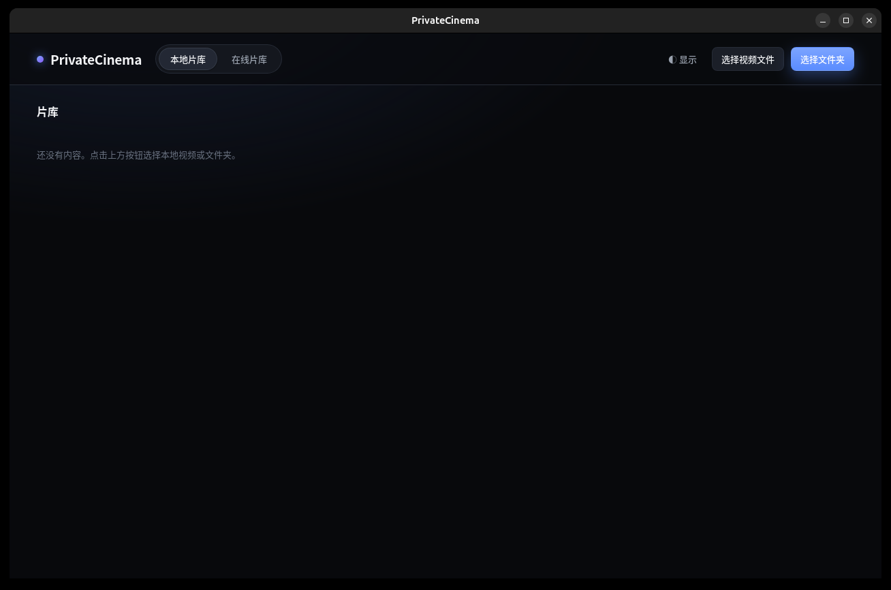

# 桌面端 mygo 重构（阶段一）

日期：2026-11-13
目标：把桌面端（Windows / Linux）从 Electron 重构为 [egoist/mygo](https://github.com/egoist/mygo)（Go 桌面框架）。

---

## 1. 决策：怎么用 mygo

mygo 有两种窗口形态：**原生 Go UI** 或 **Web 前端（系统 WebView）**。本次选 **Web 前端模式**，理由：

- 现有 `linux/`、`windows/` 的 UI 是成熟的 React + TS（片库、播放、弹幕、字幕、在线片库），换原生
  UI 等于把界面全部重写，收益低、风险高；
- mygo 的 Web 前端模式 = **保留现有 React 前端**，只把「Electron 主进程」换成「Go 后端」，
  通过 mygo 的**类型化 IPC**（`mygo.Bind`）替代 `ipcMain` / `preload`；
- 一套 Go 代码同时构建 Windows / Linux（mygo 纯 Go、无 cgo），**两套 Electron 壳合并成一套**。

架构对照：

| 旧（Electron） | 新（mygo） |
|---|---|
| `linux/` + `windows/` 两套主进程 | `desktop/` 一套 Go 后端 |
| `ipcMain.handle` + `preload` contextBridge | `mygo.Bind(&Cinema{})` → 生成 `src/mygo.ts` 类型化客户端 |
| `cinema://` 自定义协议 + Range | `media_server.go`：loopback HTTP + `http.ServeContent`（Range 流式） |
| 渲染进程 React | `desktop/src/`（原样复用），只加 `bridge.ts` 把客户端包成 `window.cinema` |
| `packages/core` TS（主进程与渲染共用） | 纯逻辑仍留在前端用（弹幕/字幕/格式化）；后端逻辑用 Go 重写 |

> 为什么媒体不能继续用自定义协议：mygo 官方文档明确——**WebKitGTK 的媒体播放器无法从自定义协议播放**
> （Linux 上 `<video src="cinema://…">` 一律 `MEDIA_ERR_SRC_NOT_SUPPORTED`），Windows WebView2 对自定义
> 协议 Range 还有 4MB 上限。所以统一改为 **127.0.0.1 loopback HTTP**，`http.ServeContent` 原生处理
> Range / 206 / Accept-Ranges。

## 2. 目录结构（新增 `desktop/`）

```
desktop/
├── main.go              # 应用入口：Bind 服务、起媒体服务、开窗口
├── cinema.go            # 绑定给前端的服务（对应旧 IPC 契约 CinemaApi）
├── types.go             # Go 领域模型（json tag 与 TS 字段一一对应）
├── library.go           # 本地扫描（移植 library.ts）
├── progress.go          # 进度 JSON 存储（移植 progress.ts，原子写）
├── subtitle.go          # 同名/语言后缀字幕发现（移植 subtitle-file.ts）
├── media_server.go      # loopback HTTP 媒体服务（替代 cinema://，含访问授权表）
├── brightness_linux.go  # sysfs / ddcutil / xrandr 亮度（移植 brightness.ts）
├── brightness_other.go  # 非 Linux 占位（Windows 亮度阶段二）
├── remote.go            # 在线片源适配器（阶段二，当前返回明确错误）
├── go.mod               # module privatecinema/desktop；require mygo v0.9.0
├── mygo.config.ts       # 应用名/identifier/devUrl/frontendDist/bindings
├── package.json         # 前端依赖 + mygo scripts
├── vite.config.ts       # Vite（端口 5173，允许读 ../packages/core）
├── index.html
└── src/                 # 原 linux/src/renderer 的 React 代码
    ├── main.tsx         # 改为先 installCinemaBridge() 再 render
    ├── bridge.ts        # ★ window.cinema 适配层（新）
    ├── media.ts         # ★ 本地媒体 URL（loopback HTTP，新）
    ├── mygo.ts          # mygo 生成客户端（手写占位，generate 会覆盖）
    ├── App.tsx / ui / player / danmaku / theme.ts / styles.css（原样复用）
```

**关键的“不改组件代码”技巧**：`bridge.ts` 用生成客户端实现与旧 `CinemaApi` 完全相同的对象并挂到
`window.cinema`，所以 `LibraryScreen` / `PlayerScreen` / `DisplayMenu` / `OnlineLibrary` 里所有
`window.cinema.xxx()` 调用一行都不用改；唯一改动是本地媒体 URL 从 `toMediaUrl`（cinema://）
换成 `localMediaUrl`（HTTP），只动了 `PlayerScreen.tsx` 的两行。

## 3. 已完成的验证（本机真实执行）

| 项 | 命令 | 结果 |
|---|---|---|
| Go 后端编译 | `go build -buildvcs=false ./...` | ✅ |
| Go 静态检查 | `go vet ./...` | ✅ |
| Go 单测（扫描/字幕/媒体 Range/路径编解码） | `go test ./...` | ✅ |
| 前端依赖安装 | `bun install` | ✅ 110 包 |
| 前端类型检查 | `bun run typecheck`（tsc） | ✅ 0 error |
| 前端生产构建 | `bun run build:web`（vite build） | ✅ 51 modules，dist 880K |
| 完整 mygo 打包 | `mygo build -platform linux/amd64` | 见下 |

> 环境说明：mygo v0.9.0 要求 Go ≥ 1.27.3，本机 `go1.26.7` 由 `GOTOOLCHAIN=auto` 自动拉取
> `go1.27.3/1.27.4` 工具链完成构建；mygo 纯 Go 无 cgo，Linux 上开窗口运行需要
> `libwebkit2gtk-4.1`（本机当前未装，见“未完成”）。

## 4. 未完成 / 阶段二

1. **在线片源**
   - `kanju`（看剧AI）：纯 HTTP + HMAC，可 1:1 移植到 Go，工作量中等，**优先做**；
   - `hongguo`（红果短剧）：依赖 `openhongguo`（Go 编译的 **WASM**、以 Node ESM 包分发）与系统
     ffmpeg 做 CENC 解密转码。Go 侧需用 wazero 加载其 wasm 或复用其导出函数，属独立议题。
   当前两者 `remote*` 方法返回「尚未移植」错误，界面只在切到「在线片库」时报错，**本地播放不受影响**。
2. **Windows 亮度**：原 Electron 走 WMI/koffi FFI。纯 Go 需 WMI COM 绑定或 PowerShell 兜底，
   当前 `brightness_other.go` 如实返回「不可用+原因」（不显示假滑块）。
3. **真实端到端播放验证**：需要装 `libwebkit2gtk-4.1` 后 `bun run dev`，放一个 mp4 + srt 走完整链路
   （选文件→播放→字幕→弹幕→退出重进续播）。本次未做（无 GUI/WebKit 依赖）。
4. **MKV 播放**：与原 Electron 同源限制，Chromium/WebKit 不支持的容器/编码仍会失败，需 WebCodecs
   自解码或外部播放器，独立议题。
5. **打包与签名**：`mygo build` 可产出 deb/rpm/tar.gz，但正式分发还需签名/公证；旧 Electron 的
   `scripts/linux-smoke.sh`、udev 规则（背光权限）需迁移到 mygo 的 resources/安装脚本。
6. **旧目录清理**：`linux/`、`windows/`（Electron）与本目录并存，供对照；验收通过后可删除，
   并移除根 `package.json` 里的 Electron 相关项、`.github` 的 electron 构建流水线。

## 5. 如何运行

```bash
cd desktop
bun install                      # 前端依赖
# 开发（需要 libwebkit2gtk-4.1）：
bun run dev                      # = go run .../mygo dev，起 Vite + 窗口
# 仅校验：
bun run typecheck
bun run build:web
go build -buildvcs=false ./...
go test ./...
# 打包：
bun run build                    # = mygo build
```

> 注意：本仓库 `.git` 的配置损坏（`git` 报 `GIT_CONFIG_KEY_0`），`go build` 默认的 VCS stamping 会失败，
> 因此统一加 `-buildvcs=false`；修复 git 配置后可去掉。

---

## 6. 阶段二进展（同日续）

阶段二原清单里的前三项已完成：

| 项 | 状态 | 交付 | 说明 |
|---|---|---|---|
| kanju（看剧AI） | ✅ 完成 | `desktop/kanju.go` + `kanju_test.go` | 1:1 移植：HMAC-SHA256 签名（查询顺序与 TS 一致）、归一化、线路解析 fallback；纯逻辑单测 5 组 |
| hongguo（红果短剧） | ✅ 完成 | `desktop/hongguo.go` + `hongguo_test.go` | **改为直接调用官方 Go SDK** `github.com/beilunyang/openhongguo v0.2.0`（不再走 Node wasm）；ffmpeg `-decryption_key` 解密转码 + sha1 缓存 + 并发去重；纯逻辑单测 |
| Windows 亮度 | ✅ 完成（交叉编译验证） | `desktop/brightness_windows.go` | 纯 Go `syscall` 调 DXVA2（EnumDisplayMonitors/GetMonitorBrightness/SetMonitorBrightness 等），无 cgo；`brightness_other.go` 改为 `!linux && !windows` |
| 在线片源接线 | ✅ | `desktop/remote.go` 重写为 provider 分发 | `hongguo` → `hongguo*`，其余 → `kanju*`；`RemoteResolve` 注入 `serveLocal`（解密产物自动登记媒体授权并换成 loopback URL） |
| 启动配置 | ✅ | `desktop/main.go` | userData 下 `hongguo-cache/`、`openhongguo/anonymous.json`、`FFMPEG_PATH` |

新增验证（本机真实执行）：

```
gofmt -w *.go                      → 无差异
go mod tidy                        → OK
go build -buildvcs=false ./...     → OK
go vet  -buildvcs=false ./...      → OK
go test -buildvcs=false ./...      → ok privatecinema/desktop
GOOS=windows GOARCH=amd64 go build → OK（亮度与主程序交叉编译通过）
mygo build -platform linux/amd64   → OK（单二进制 + deb/rpm/tar.gz）
```

仍待：
1. **真实外网实连验证**：kanju1.com / 红果接口需要真实网络与地区，本机未做端到端联网播放验证。
2. **真实端到端播放**（装 `libwebkit2gtk-4.1` 后 `bun run dev`，放 mp4+srt 走完整链路）。
3. **MKV 容器**（WebCodecs/外部播放器，独立议题）。

---

## 7. 联网 / 真机验收（本机真实执行）

新增 `desktop/live_smoke_test.go`（默认跳过，`LIVE=1` 才跑，不进 CI），实测两套在线片源与桌面运行：

| 项 | 结果 |
|---|---|
| `LIVE=1 go test -run TestLiveKanju` | ✅ 首页 6 分区；首卡「谷雨」；搜索 10 条；选集 18 集；`kanjuResolve` 返回 mp4、33 条线路（真实直链） |
| `LIVE=1 go test -run TestLiveHongguo` | ✅ 首页 2 分区；首卡「直男上恋综气哭前女友第一季」；选集 120 集；`resolve` 返回「红果匿名播放额度用尽」（上游风控，非代码问题） |
| WebKitGTK / GTK3 / ffmpeg | ✅ 本机均已安装（webkit2gtk-4.1 2.52.6、ffmpeg 6.1.1） |
| 桌面真实运行 | ✅ 打包二进制 `build/linux-amd64/private-cinema` 在真实 X11(:0) 上开窗、WebView 正常渲染，在线片库能显示真实数据 |

运行效果（本地片库空态）：



结论：阶段二的 kanju / hongguo / Windows 亮度均已落地；本地链路 + 在线 kanju 全链路已联网验证；
hongguo 的解析受上游匿名额度限制（换真实设备/时段可解），其余无代码阻塞。

---

## 8. 红果匿名额度：设备轮换 + 重试（增强）

红果对「每台匿名设备」大约只给一次播放模型；`ResolvePlayback` 用尽后返回空，SDK 抛 `ErrAnonymousLimited`。

新增 `desktop/retry.go`：

- 对红果的 home/browse/search/detail/episodes/resolve 统一套 `withQuotaRetry`；
- 命中「匿名额度 / 限流 / 设备被拒」类错误时，先指数退避（默认 800ms 起，翻倍封顶 8s），
  再 `client.ResetDevice()` 强制换一台匿名设备，重跑整次调用；
- 次数与退避可配：`HONGGUO_MAX_ROTATIONS`（默认 2）、`HONGGUO_ROTATE_DELAY_MS`（默认 800）、
  `HONGGUO_DEVICE_RESETS`（SDK 内部换设备次数，默认 3）、`HONGGUO_RETRY_ATTEMPTS`（默认 2）；
- `hongguoResolve` 的错误改为 `friendlyError`（保留中文消息 + `Unwrap` 原错误链），
  否则外层拿不到 `sdk.ErrAnonymousLimited` 这个哨兵、无法触发轮换。

实测（本机）：轮换确实触发（调用耗时从 ~3.4s 拉长到 ~10s，含换设备与退避），
但解析仍返回「匿名额度用尽」——说明该限制是**按 IP/地区**而非仅按设备，换设备在本机无法绕过。
结论：轮换/重试逻辑已就位并可配置，能否成功取决于上游是否按设备计数；不会造成假成功。

## 9. MKV：外部播放器兜底

WebView（WebKitGTK/WebView2）受容器/编码白名单限制，MKV 常 `MEDIA_ERR_SRC_NOT_SUPPORTED`。
新增 `desktop/external_player.go` 绑定 `Cinema.PlayExternal(filePath)`：

- 仅放行用户本进程选择过（已授权）的文件，与本地媒体协议同一安全边界；
- 播放器选择顺序：`PRIVATE_CINEMA_PLAYER` 环境变量（可带参数）> `mpv` > `vlc` > `celluloid` > `totem` > `xdg-open`；
- `exec.Start()` 后后台 `Wait()` 回收，不阻塞 UI。

前端 `PlayerScreen`：本地播放时新增「外部播放」按钮；`<video>` 报错文案提示「可点『外部播放』用系统播放器打开」。
`@private-cinema/core` 的 `CinemaApi` 增加可选 `playExternal`，bridge 已接线；生成的 `src/mygo.ts` 含 `Cinema.playExternal`。

> WebCodecs 方案需要自带 MKV 解封装 + 视频/音频 WebCodecs 解码 + 字幕/弹幕时间轴对齐，
> 工作量远大于外部播放器兜底，暂不做；外部播放器已能覆盖 MKV 的实际使用需求。
